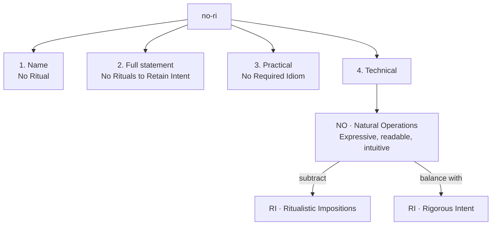

# Overview

no-ri is a modern, statically typed, natively compiled programming language designed for expressive, safe, and high-performance development of utilities, applications, services, native software libraries, and lower-level work, including embedded software and operating-system components.

A core aim is to combine expressive and elegant syntax with concise everyday code. The design focuses on keeping the language cohesive, simple to read, write, and understand. In no-ri, common tasks require little ceremony, while more complex operations such as data ownership, concurrency, interoperability, and direct system operations remain accessible through explicit mechanisms.

**Expressive by default. Explicit where it matters. Powerful without unnecessary complexity.**

The name **no-ri** begins with **No Ritual**, a call to avoid unnecessary ceremony, boilerplate, and complexity. Its full statement, **No Rituals to Retain Intent**, explains the purpose of removing that ceremony. The dash reads as “to,” linking the removal of what obscures intent to the preservation of meaningful semantics.

In practice, **No Required Idiom** means choosing the paradigm and abstractions that fit the problem. Procedural, object-oriented, functional, and systems-oriented techniques are available as the context calls for them.

At the technical level, **Natural Operations minus Ritualistic Impositions, balanced with Rigorous Intent** gives the dash two further readings. As “minus,” it calls for removing redundant syntax, arbitrary restrictions, and language-imposed ceremony. As “balanced with,” it pairs readable, intuitive expression with static rigor, safety, predictable performance, and explicit control. The language infers what it can safely, omits what it can without ambiguity, and requires explicitness where correctness, ownership, mutation, error handling, concurrency, interoperability, or performance depend on it.



## Tools and file formats

| Component                    | Name       |
| ---------------------------- | ---------- |
| Language                     | no-ri      |
| Website                      | no-ri.dev  |
| Interpreter and compiler CLI | no-ri      |
| Source extension             | .no-ri     |
| Manifest                     | no-ri.toml |
| Debugger                     | no-ri-db   |
| Language server              | no-ri-lsp  |

## Programming model

Value objects provide value semantics, entity objects provide reference semantics and identity, and variant objects represent a fixed set of cases with optional associated values. Protocols describe shared behaviour. An entity can derive statically from a concrete prototype to produce an independent, concrete, final type. Derivation creates no subtype relationship. Protocol conformance is the only form of object polymorphism.

Type checking and inference work with generics, closures, and computed properties. Modules organise declarations and control visibility, and packages bound module extension. Optional values make absence explicit. Error contracts describe recoverable failures.

Native applications use automatic reference counting (ARC) to manage reference lifetimes. Borrowing, explicit memory management, and unsafe scopes support progressively lower-level programming. Detailed lifetime, aliasing, and concurrency rules are specifications in development. Native compilation and efficient representations aim to keep performance predictable, with costs depending on allocation, ownership, and representation.

The no-ri toolchain targets native executables, shared libraries, static libraries, and executables for constrained freestanding targets. The backend and intermediate representation remain implementation decisions.

## Small example

```no-ri
greet |name: string| -> string do
  "Hello, \(name)"
end

echo(greet("Alice"))
```

A function declaration can start directly with its name. Parameters appear between bars, and executable bodies use `do ... end`. With an explicit `->` result declaration, the final expression or a `return` statement supplies the result. A function without a result declaration returns no value.

## Independence and interoperability

no-ri has its own language semantics, standard library, compiler, and execution model. The C ABI is the primary foreign-function boundary. Ruby and Swift interoperability is optional, and native programs that omit them can run independently of CRuby or the Swift runtime.

no-ri is developed alongside n-os (a specialized unix inspired operating system) and can also build standalone software. Its semantics are independent of any particular operating-system filesystem hierarchy or package manager.

## Everyday programming

Global `echo`, `warn`, and `debug` provide configurable output. `terminal` is a separate advanced terminal module. Construct value and entity instances with `Type.initial(...)`. Initializers define state and can use property-bound parameters. The complete standard-library API is a specification in development.

Continue with the [design principles](design.md) and [language reference](language/README.md).
